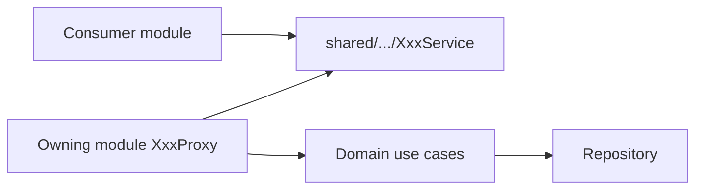

# Module Communication (peakhub_server)

Feature modules **must not** depend on each other’s domain/data packages.
Cross-module access goes only through **shared Service interfaces** implemented
by **Proxies** in the owning module.

## Hard rules

1. **Consumers inject only `XxxService`** from `shared/<module>/domain/`.
2. **Use cases stay inside the owning module** — domain models / Results only.
3. **The Proxy** maps shared ↔ domain and contains **no business logic**.
4. **Shared contracts** live under `shared/<feature>/domain/` (`XxxService`,
   `model/*Shared`, optional sealed `*Result`).
5. **`asShared()` / `asDomain()`** live in the owning module, not in `shared/`.

## Package layout

| Piece | Location |
| :--- | :--- |
| Service API | `shared/<feature>/domain/` |
| Shared models | `shared/<feature>/domain/model/` |
| Proxy | `<feature>/domain/` |
| Use cases | `<feature>/domain/usecase(s)/` |
| Domain models | `<feature>/domain/model/` |
| DI binding | `<feature>/di/` |

## Anti-patterns

| Don’t | Do instead |
| :--- | :--- |
| Use case takes `*Shared` | Use case takes domain; Proxy maps |
| Module A imports B’s repository/use case | Depend on B’s `XxxService` |
| Put `asShared()` in `shared/` | Keep mappers next to domain models |
